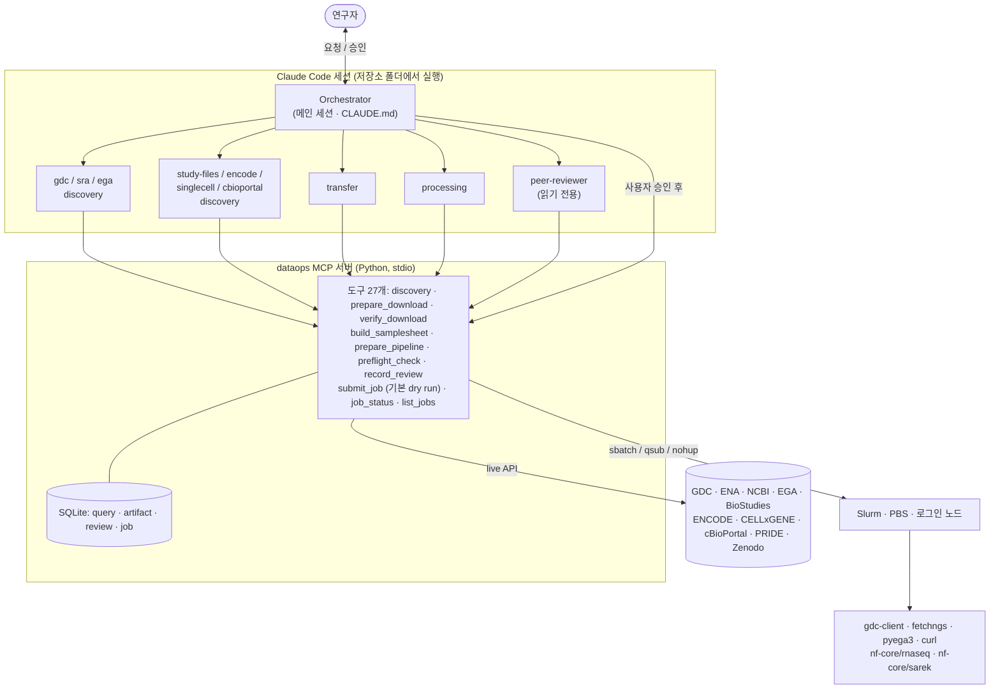

# Genomics DataOps Team

**자연어로 요청하면 공공 생물학 데이터를 찾고, 연구실 HPC에서 검증된 job으로 내려받고, nf-core 파이프라인까지 준비합니다. 모든 숫자는 실제 API 조회 결과에서 나오고, 사용자 승인 없이는 아무것도 실행하지 않습니다.**

[English README](README.md)

## 받아올 수 있는 데이터베이스

<table>
<tr>
<td align="center" width="25%"><a href="https://portal.gdc.cancer.gov/"></a><br><sub><b>NCI GDC</b><br>TCGA · TARGET · CPTAC</sub></td>
<td align="center" width="25%"><a href="https://www.ncbi.nlm.nih.gov/"></a><br><sub><b>NCBI SRA · GEO · dbGaP</b><br>원시 read · 처리 파일 · 보호 데이터</sub></td>
<td align="center" width="25%"><a href="https://www.ebi.ac.uk/ena/browser/"></a><br><sub><b>ENA</b><br>원시 read (INSDC)</sub></td>
<td align="center" width="25%"><a href="https://www.ddbj.nig.ac.jp/"></a><br><sub><b>DDBJ</b><br>원시 read (INSDC)</sub></td>
</tr>
<tr>
<td align="center"><a href="https://ega-archive.org/"></a><br><sub><b>EGA</b><br>controlled 인간 데이터</sub></td>
<td align="center"><a href="https://www.ebi.ac.uk/biostudies/arrayexpress"></a><br><sub><b>ArrayExpress</b><br>기능 유전체</sub></td>
<td align="center"><a href="https://www.encodeproject.org/"></a><br><sub><b>ENCODE</b><br>조절 유전체</sub></td>
<td align="center"><a href="https://cellxgene.cziscience.com/"></a><br><sub><b>CZ CELLxGENE</b><br>단일세포 h5ad</sub></td>
</tr>
<tr>
<td align="center"><a href="https://www.cbioportal.org/"></a><br><sub><b>cBioPortal</b><br>처리된 암 유전체</sub></td>
<td align="center"><a href="https://www.ebi.ac.uk/pride/"></a><br><sub><b>PRIDE</b><br>프로테오믹스</sub></td>
<td align="center"><a href="https://zenodo.org/"></a><br><sub><b>Zenodo</b><br>DOI로 공개된 논문 데이터</sub></td>
<td align="center"><a href="https://nf-co.re/"></a><br><sub><b>nf-core</b><br>rnaseq · sarek · fetchngs</sub></td>
</tr>
</table>

여기에 더해 직접 지정한 공개 HTTPS 파일(Ensembl/GENCODE 레퍼런스, gnomAD, 1000 Genomes 등)도 `url_inspect`로 받을 수 있습니다.
<sub>로고는 각 기관의 상표이며 지원 대상을 표시하는 용도로만 씁니다([출처](docs/logos/SOURCES.md)).</sub>

---

## 무엇을 위한 것인가

공공 데이터를 재분석하려면 분석 전에 하루가 사라집니다. 포털에서 필터를 누르고, GEO 번호를 SRA run으로 바꾸고, manifest와 `sbatch` 스크립트를 쓰고, 계산 노드에 인터넷이 없다는 걸 알게 되고, samplesheet를 손으로 만들고, 사흘 뒤에야 레퍼런스가 안 맞았다는 걸 발견합니다.

이 저장소는 그 일을 **연구실 HPC의 [Claude Code](https://code.claude.com/docs) 안에서 돌아가는 DataOps 팀**으로 바꿉니다.

```
"PRJNA… RNA-seq 받아서 nf-core/rnaseq 돌려줘"
   → discovery agent가 live API 조회 (개수·용량·layout·종, 사용한 쿼리까지)
   → 사용자 확인 → transfer agent가 다운로드 job 작성 → peer-reviewer 검수 → 사용자 승인 → Slurm/PBS 실행
   → manifest 대비 검증 → processing agent가 samplesheet와 버전 고정 nextflow job 작성
   → 검수 → 승인 → 제출 → 요청하면 상태 보고
```

LLM은 계획과 파라미터만 만듭니다. 다운로드와 계산은 검증된 도구(gdc-client, nf-core/fetchngs, pyega3, curl, nf-core 파이프라인)가 스케줄러 job으로 수행합니다.

### 무엇이 달라지나

| 단계 | 지금 손으로 하는 일 | 이 팀이 하는 일 |
|---|---|---|
| 데이터 찾기 | 포털 필터 클릭, GEO→SRA 매핑, 파일 크기 합산 | "TCGA-BRCA open WGS BAM 몇 개, 몇 TB?" → API에서 나온 답과 사용한 쿼리 |
| 다운로드 | manifest, 클라이언트 옵션, sbatch 작성. 계산 노드가 오프라인이면 막힘 | 스크립트 자동 생성, 인터넷 되는 노드(계산/전송 파티션/로그인 노드)로 자동 배치 |
| 확인 | 누락·잘린 파일, md5를 일일이 | manifest 대조, 크기·md5/sha 검사, 이어받기 재실행 |
| samplesheet | 수백 행 CSV를 손으로, paired/single 실수 | rnaseq·sarek 스키마로 자동 생성 |
| 파이프라인 | 버전·레퍼런스·profile·work dir·-resume을 매번 | 버전 고정 스크립트 + 사이트 config |
| 실수 잡기 | 보통 며칠 뒤 | 제출 전에: 종·레퍼런스 불일치, mate 누락, 디스크, controlled 취급 |
| 기록 | "그때 어떤 버전 받았더라?" | 모든 조회·스크립트 해시·검수·job이 SQLite에 |
| 모니터링 | squeue와 로그 뒤지기 | "어제 job 어때?" → 상태와 오류 요약 |

하지 않는 일: 하류 통계 분석과 생물학적 해석, DAC/dbGaP 승인 신청, 계산 자원 제공.

---

## 지원 데이터베이스 상세

| 데이터베이스 | 받을 수 있는 것 | 접근 | 다운로드 방식 | 담당 subagent |
|---|---|---|---|---|
| NCI GDC | 정렬 BAM, 변이(VCF/MAF), 발현 count, 메틸화, CNV, 임상 | open + controlled(dbGaP) | gdc-client | `gdc-discovery` |
| SRA / ENA / DDBJ | run 단위 FASTQ (모든 생물종·assay) | open | nf-core/fetchngs | `sra-discovery` |
| NCBI GEO → SRA | GSE/GSM 뒤의 원시 read | open | nf-core/fetchngs | `sra-discovery` |
| dbGaP (SRA 경유) | 보호된 인간 run | controlled | fetchngs `--dbgap_key` (.ngc, SRA Toolkit) | `sra-discovery` |
| EGA | 데이터셋별 BAM/CRAM/VCF/FASTQ | controlled | pyega3 | `ega-discovery` |
| NCBI GEO (파일) | supplementary, series matrix (count matrix, 마이크로어레이, RAW.tar) | open | curl manifest | `study-files-discovery` |
| ArrayExpress | 처리 데이터, MAGE-TAB (원시 read는 ENA 링크) | open | curl manifest | `study-files-discovery` |
| ENCODE | peaks, signal track, alignment, FASTQ | open | curl manifest (md5) | `encode-discovery` |
| CZ CELLxGENE | 표준화된 단일세포 AnnData(.h5ad) | open | curl manifest | `singlecell-discovery` |
| cBioPortal | study별 변이·CNA·발현·임상 | open | curl manifest (study tarball) | `cbioportal-discovery` |
| PRIDE | 원시 spectra, 검색 결과 | open | curl manifest (md5) | `study-files-discovery` |
| Zenodo | DOI로 공개된 모든 데이터 | open | curl manifest (md5) | `study-files-discovery` |
| 직접 URL | 레퍼런스, gnomAD, 1000 Genomes 등 | open | curl manifest | `study-files-discovery` |

에이전트는 `list_databases` 도구로 이 카탈로그와 지원하지 않는 자원(및 이유)을 실행 중에 확인합니다.

## 공공 데이터를 받는 데 이 정도면 충분한가

시퀀싱 중심 유전체 연구 기준으로 주요 공개 경로는 덮습니다. 원시 read 아카이브 전부(INSDC 세 곳은 서로 미러링), 대형 controlled 인간 아카이브 두 곳과 dbGaP 보호 SRA, 주요 암·기능·조절·단일세포 자원, 그리고 논문이 처리 파일을 올리는 곳들입니다.

| 데이터 종류 | 지원 | 아직 미지원 |
|---|---|---|
| 원시 시퀀싱 read | SRA, ENA, DDBJ, GEO→SRA | 중국 NGDC GSA (공개 파일은 `url_inspect`로 가능) |
| controlled 인간 유전체 | GDC controlled, EGA, dbGaP 보호 SRA | UK Biobank, All of Us, AnVIL/Terra (클라우드 분석 환경 전용), JGA |
| 암 유전체 | GDC(원자료·하모나이즈), cBioPortal(처리 데이터) | ICGC: 데이터 포털이 2024년 6월 종료, 기존 원자료는 주로 EGA |
| 발현·기능 유전체 | GEO 파일, ArrayExpress | Expression Atlas, Single Cell Expression Atlas (전용 모듈) |
| 조절 유전체 | ENCODE | Roadmap, 4DN, IGVF (전용 모듈) |
| 단일세포 | CELLxGENE | HCA Data Portal, Broad Single Cell Portal |
| 프로테오믹스 | PRIDE | MassIVE, jPOST |
| 레퍼런스·집단 변이 | `url_inspect` (Ensembl, GENCODE, UCSC, gnomAD, 1000 Genomes) | — |
| 대사체, 이미징 | — | MetaboLights, Metabolomics Workbench, TCIA, IDR |

새 저장소는 쉽게 추가됩니다. discovery 모듈은 URL manifest(`url, filename, size, checksum`)만 만들면 되고, 다운로드·검증·검수·제출은 공통입니다.

---

## 동작 구조



### 안전장치

| 원칙 | 강제 방법 |
|---|---|
| 역할 분리 | subagent의 `tools`에 자기 MCP 도구만. discovery는 다운로드 불가, transfer·processing은 제출 불가, reviewer는 판정 기록 외 읽기 전용 |
| 근거 기반 | 모든 discovery 결과에 `query_id`와 실제 API 호출(`api_queries`)이 붙고 SQLite에 저장. 숫자는 도구 결과로만 보고 |
| 추론과 실행 분리 | 스크립트는 테스트된 Jinja2 템플릿으로 생성. `sbatch`·`qsub`·`nextflow run`·`gdc-client`·`pyega3` 직접 실행은 settings에서 deny(보조 장치) |
| 승인 후 실행 | `submit_job` 기본 `dry_run=True`. 실제 제출은 `confirm=True` + `dry_run=False` + **스크립트와 입력 전체의 sha256**과 일치하는 검수 PASS + 동시 실행 한도 미만. 또 Claude Code가 호출마다 사람에게 승인을 묻습니다(`ask` 규칙 + `anthropic/requiresUserInteraction`) |
| controlled 데이터 | DAC 승인·기관 규정·저장 위치 확인(acknowledge) 필수, 토큰·키는 경로로만 전달(내용 안 읽음), 권한 600 점검, `umask 077`, 로그 마스킹 |

자동 검수(`preflight_check`)가 잡는 것: 입력 종 ≠ 레퍼런스 종, 정렬 BAM assembly ≠ 레퍼런스(예: GDC GRCh38.d1.vd1 vs sarek 기본 GATK.GRCh38), paired 메타데이터인데 mate 누락, sex가 필요한 sarek 도구인데 NA, 디스크 부족, 버전 미고정, 오프라인 계산 노드에서 iGenomes, 생성 후 수정된 스크립트·입력.

---

## 설치

요구사항: Linux HPC 로그인 노드, Python ≥ 3.10, [Claude Code](https://code.claude.com/docs), `curl`. 파이프라인 실행 시 Java 17+, Nextflow ≥ 25.10.4, Singularity/Apptainer.

```bash
git clone -b claude/genomics-dataops-team https://github.com/Sejung98/Personal_dataops_agent.git genomics-dataops-team
cd genomics-dataops-team && ./install.sh        # PYTHON=python3.11 ./install.sh 또는 --run-tests
vi config.yaml && claude                         # 반드시 저장소 루트에서 실행
```

첫 실행 때 폴더 신뢰(trust)와 `dataops` MCP 서버 사용을 허용하세요.

### config.yaml에서 채울 항목

| 항목 | 설명 |
|---|---|
| `scheduler` | `slurm` / `pbs` / `local` |
| `partition`, `account` | 기본 파티션(큐)과 과금 계정 |
| `transfer_node_mode` | 다운로드 실행 위치: `compute`(계산 노드 인터넷 가능) / `dtn`(전송 파티션) / `login` |
| `transfer_partition` | `dtn`일 때만 |
| `container` | `singularity` / `apptainer` / `docker` |
| `data_root`, `work_dir`, `singularity_cache` | 대용량 스토리지 경로 |
| `gdc_token_path`, `ega_credentials_path`, `dbgap_key_path` | controlled 데이터용 크리덴셜 **경로** (`chmod 600`) |
| `references` | 로컬 fasta/gtf와 `assembly`, `species` (계산 노드가 오프라인이면 필수) |

계산 노드 인터넷 확인: `srun --pty curl -sI https://api.gdc.cancer.gov/status`

---

## 사용 예시

**"TCGA-BRCA의 WGS BAM 중 open access인 것 몇 개, 몇 TB인지 알려줘"**: `gdc-discovery`가 `gdc_get_field_values`로 값 철자를 확인하고 `gdc_search_files`로 조회해 개수·용량·사용한 필터를 보고합니다. 다운로드는 하지 않습니다. GDC에서 원시 서열 파일은 대부분 controlled라([GDC 문서](https://docs.gdc.cancer.gov/Encyclopedia/pages/Controlled_Access/)) open 결과가 0일 수 있고, 그때는 open/controlled 분포를 함께 보여줍니다.

**"PRJNA○○○○ RNA-seq 받아서 nf-core/rnaseq 돌려줘"**: `sra-discovery` → 사용자 확인 → `transfer`(fetchngs job) → `peer-reviewer` → 승인 → `submit_job` → `verify_download` → `processing`(samplesheet, 로컬 레퍼런스로 rnaseq job) → 검수 → 승인 → 제출.

**"어제 제출한 job 상태 알려줘"**: Orchestrator가 `list_jobs(since_hours=48)`와 `job_status`로 상태와 로그 오류를 요약합니다.

| 요청 | 경로 |
|---|---|
| "GSE…의 count matrix 받아줘" | `geo_files` → curl job (크기 검증; GEO는 체크섬 없음) |
| "K562 CTCF ChIP-seq peak, GRCh38" | `encode_search` → `encode_files(assembly="GRCh38", output_type=…)` → md5 검증 curl job |
| "COVID-19 폐 단일세포 데이터셋" | `cellxgene_search(tissue="lung", disease="COVID-19")` → h5ad manifest |
| "TCGA 유방암 변이·임상 표" | `cbioportal_search(keyword="breast")` → study tarball, hg19/hg38 표시 |
| "PXD… 파일" / "10.5281/zenodo.… 데이터" | `pride_files` / `zenodo_files` → md5 검증 curl job |
| "phs… dbGaP 승인 받았어" | `sra_search`가 보호 run 표시 → `prepare_download(use_dbgap=True)` + `.ngc` 키 |

## 테스트

```bash
.venv/bin/python -m pytest -q            # 단위 테스트 (HTTP는 respx mock, 일부는 실제 API 응답 캡처 사용)
.venv/bin/python -m pytest -m live -s    # 실제 API 스모크 테스트 (인터넷 필요)
```

## 한계

- **controlled 데이터는 DAC 승인과 기관 규정을 먼저 확인하세요.** 도구는 확인 기록과 권한만 점검할 수 있고 승인 범위는 확인하지 못합니다.
- API 클라이언트는 공식 문서와 공식 클라이언트 소스로 구현했고, 개발 환경에서는 API에 직접 접속하지 못했습니다. 서버에서 `pytest -m live -s`를 한 번 실행하세요.
- GDC RNA-seq는 정렬 BAM과 STAR counts로 제공되어 FASTQ가 아닙니다. sarek FASTQ 입력은 paired-end만 가능합니다.
- 오프라인 계산 노드에서는 `prepare_pipeline`이 주는 prefetch 명령(파이프라인·플러그인·컨테이너)과 로컬 레퍼런스가 필요합니다.
- dbGaP 다운로드는 repository key(`.ngc`)를 씁니다. JWT cart는 AWS/GCP에서만 동작합니다.
- 디스크 추정은 휴리스틱입니다. SQLite 상태 DB는 가능하면 NFS/Lustre 밖에 두세요.

## 참고문헌

[English README의 References](README.md#references)와 같습니다(19편, 모두 PubMed에서 확인, DOI 링크 포함).
