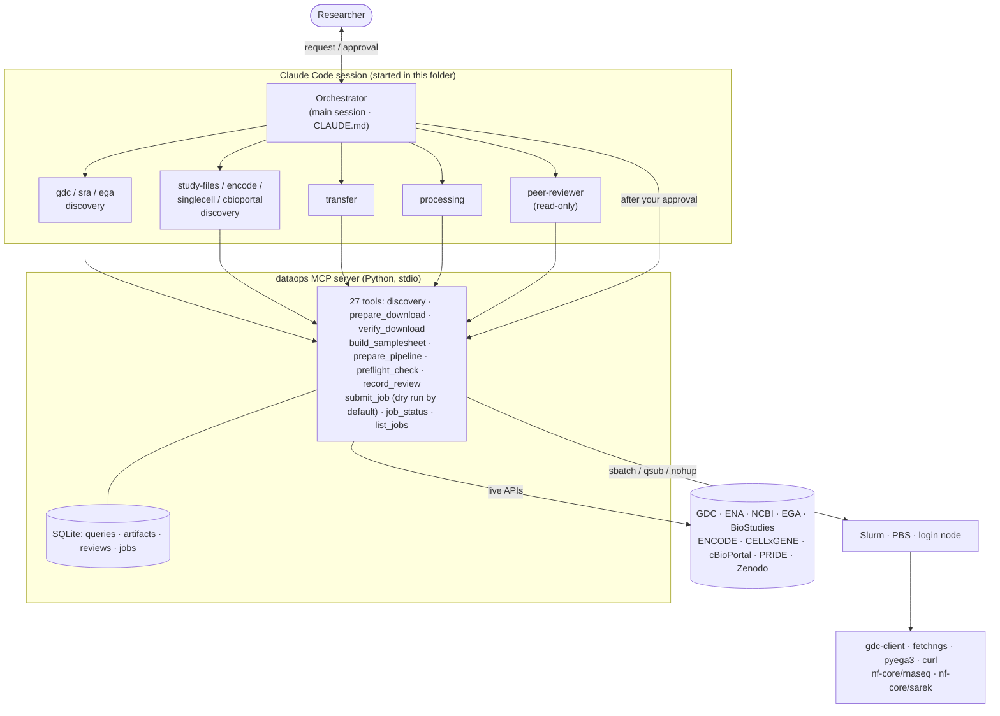

# Genomics DataOps Team

**Ask in plain language. It finds public biological datasets, downloads them as verified jobs on your own HPC, and prepares nf-core pipelines — with every number traced to a live API call and nothing executed without your approval.**

[한국어 README](README.ko.md)

## Databases it can fetch from

<table>
<tr>
<td align="center" width="25%"><a href="https://portal.gdc.cancer.gov/"></a><br><sub><b>NCI GDC</b><br>TCGA · TARGET · CPTAC</sub></td>
<td align="center" width="25%"><a href="https://www.ncbi.nlm.nih.gov/"></a><br><sub><b>NCBI SRA · GEO · dbGaP</b><br>reads · processed · controlled</sub></td>
<td align="center" width="25%"><a href="https://www.ebi.ac.uk/ena/browser/"></a><br><sub><b>ENA</b><br>raw reads (INSDC)</sub></td>
<td align="center" width="25%"><a href="https://www.ddbj.nig.ac.jp/"></a><br><sub><b>DDBJ</b><br>raw reads (INSDC)</sub></td>
</tr>
<tr>
<td align="center"><a href="https://ega-archive.org/"></a><br><sub><b>EGA</b><br>controlled human data</sub></td>
<td align="center"><a href="https://www.ebi.ac.uk/biostudies/arrayexpress"></a><br><sub><b>ArrayExpress</b><br>functional genomics</sub></td>
<td align="center"><a href="https://www.encodeproject.org/"></a><br><sub><b>ENCODE</b><br>regulatory genomics</sub></td>
<td align="center"><a href="https://cellxgene.cziscience.com/"></a><br><sub><b>CZ CELLxGENE</b><br>single-cell h5ad</sub></td>
</tr>
<tr>
<td align="center"><a href="https://www.cbioportal.org/"></a><br><sub><b>cBioPortal</b><br>processed cancer genomics</sub></td>
<td align="center"><a href="https://www.ebi.ac.uk/pride/"></a><br><sub><b>PRIDE</b><br>proteomics</sub></td>
<td align="center"><a href="https://zenodo.org/"></a><br><sub><b>Zenodo</b><br>paper data with a DOI</sub></td>
<td align="center"><a href="https://nf-co.re/"></a><br><sub><b>nf-core</b><br>rnaseq · sarek · fetchngs</sub></td>
</tr>
</table>

Plus any public HTTPS file you point it at (Ensembl/GENCODE references, gnomAD, 1000 Genomes, …) through `url_inspect`.
<sub>Logos are trademarks of their owners, shown only to identify supported resources ([sources](docs/logos/SOURCES.md)).</sub>

---

## What it is for

Re-analysing public data usually means a day of glue work before any science: clicking through portals, translating a GEO series into SRA runs, writing manifests and `sbatch` scripts, discovering that compute nodes have no internet, hand-writing samplesheets, and finding out three days later that the reference genome did not match.

This repository turns that work into a **DataOps team that runs inside [Claude Code](https://code.claude.com/docs) on your lab's HPC**:

```
"Get the RNA-seq of PRJNA… and run nf-core/rnaseq"
   → discovery agent queries the live API (counts, sizes, layout, species — with the exact query it used)
   → you confirm → transfer agent writes a download job → peer reviewer checks it → you approve → Slurm/PBS runs it
   → download verified against the manifest → processing agent writes the samplesheet and a version-pinned
     nextflow job → reviewed → approved → submitted → status on request
```

The language model only plans and fills in parameters. Downloads and computation are done by established tools (gdc-client, nf-core/fetchngs, pyega3, curl, nf-core pipelines) as scheduler jobs.

### What changes for you

| Step | By hand today | With the team |
|---|---|---|
| Find data | Portal filters, GEO→SRA mapping, adding up file sizes | Ask "how many open WGS BAMs in TCGA-BRCA, how many TB?" — answer comes from the API, with the query shown |
| Download | Manifests, client flags, `sbatch` scripts; stuck when compute nodes are offline | Job script generated and routed to a node that has internet (compute / transfer partition / login node) |
| Check | Missing files, truncated files, md5 by hand | Manifest comparison, size and md5/sha checks, resumable re-runs |
| Samplesheet | Hundreds of CSV rows, paired/single mistakes | Generated in the nf-core/rnaseq or sarek schema |
| Run pipeline | Version, reference, profile, work dir, `-resume` every time | Version-pinned script with a site config |
| Catch mistakes | Usually days later | Before submission: species/reference mismatch, lost mates, disk space, controlled-data handling |
| Provenance | "Which version did I download?" | Every query, script hash, review and job stored in SQLite |
| Monitoring | `squeue` and log digging | "How are yesterday's jobs?" → status and error summary |

What it does **not** do: downstream statistics or biological interpretation, apply for DAC/dbGaP access for you, or provide compute.

---

## Supported databases in detail

| Database | What you get | Access | Downloaded with | Subagent |
|---|---|---|---|---|
| NCI GDC | Aligned reads (BAM), variants (VCF/MAF), expression counts, methylation, CNV, clinical | open + controlled (dbGaP) | gdc-client | `gdc-discovery` |
| SRA / ENA / DDBJ | FASTQ per run, any organism or assay | open | nf-core/fetchngs | `sra-discovery` |
| NCBI GEO → SRA | Raw reads behind a GSE/GSM | open | nf-core/fetchngs | `sra-discovery` |
| dbGaP (via SRA) | Protected human runs | controlled | fetchngs `--dbgap_key` (.ngc, SRA Toolkit) | `sra-discovery` |
| EGA | BAM/CRAM/VCF/FASTQ per dataset | controlled | pyega3 | `ega-discovery` |
| NCBI GEO (files) | Supplementary files, series matrix (count matrices, microarray, RAW.tar) | open | curl manifest | `study-files-discovery` |
| ArrayExpress | Processed data, MAGE-TAB (raw reads link to ENA) | open | curl manifest | `study-files-discovery` |
| ENCODE | Peaks, signal tracks, alignments, FASTQ | open | curl manifest (md5) | `encode-discovery` |
| CZ CELLxGENE | Curated single-cell AnnData (.h5ad) | open | curl manifest | `singlecell-discovery` |
| cBioPortal | Mutations, CNA, expression, clinical per study | open | curl manifest (study tarball) | `cbioportal-discovery` |
| PRIDE | Raw spectra, search results | open | curl manifest (md5) | `study-files-discovery` |
| Zenodo | Anything deposited with a DOI | open | curl manifest (md5) | `study-files-discovery` |
| Direct URLs | References, gnomAD, 1000 Genomes, … | open | curl manifest | `study-files-discovery` |

`list_databases` returns this catalog to the agent at runtime, including what is *not* supported and why.

## Is this enough for public data?

For sequencing-centred genomics the set covers the main public routes: every raw-read archive (the three INSDC members mirror each other), the two large controlled-access human archives plus dbGaP-protected SRA data, the main cancer, functional, regulatory and single-cell resources, and the places where papers leave processed files.

| Kind of data | Covered by | Not covered (yet) |
|---|---|---|
| Raw sequencing reads | SRA, ENA, DDBJ, GEO→SRA | China NGDC GSA (public files can go through `url_inspect`) |
| Controlled human genomes | GDC controlled, EGA, dbGaP-protected SRA | UK Biobank, All of Us, AnVIL/Terra (analysis happens in cloud enclaves), JGA |
| Cancer genomics | GDC (raw and harmonised), cBioPortal (processed) | ICGC: the data portal closed in June 2024; legacy raw data is mostly at EGA |
| Expression / functional genomics | GEO files, ArrayExpress | Expression Atlas, Single Cell Expression Atlas (dedicated modules) |
| Regulatory genomics | ENCODE | Roadmap, 4DN, IGVF (dedicated modules) |
| Single cell | CELLxGENE | HCA Data Portal, Broad Single Cell Portal |
| Proteomics | PRIDE | MassIVE, jPOST |
| References and population variation | `url_inspect` (Ensembl, GENCODE, UCSC, gnomAD, 1000 Genomes) | — |
| Metabolomics, imaging | — | MetaboLights, Metabolomics Workbench, TCIA, IDR |

New sources are cheap to add: a discovery module only has to produce a URL manifest (`url, filename, size, checksum`). Download, verification, review and submission are shared.

---

## How it works



### Safety by design

| Principle | How it is enforced |
|---|---|
| Separate roles | Each subagent's `tools` list only contains its own MCP tools. Discovery agents cannot download; transfer and processing agents cannot submit; the reviewer is read-only apart from recording its verdict. |
| Grounded answers | Every discovery result carries a `query_id` and the exact API calls (`api_queries`) it came from, stored in SQLite. Agents are told to report numbers only from tool results. |
| Reasoning ≠ execution | Scripts come from tested Jinja2 templates. Direct `sbatch`, `qsub`, `nextflow run`, `gdc-client`, `pyega3` from the shell are denied in `.claude/settings.json` (a backstop; the server checks below are the real guard). |
| Approval before execution | `submit_job` defaults to `dry_run=True`. A real submission needs `confirm=True`, `dry_run=False`, a peer-review PASS that matches the **sha256 of the script and all its inputs**, and a free slot under `max_concurrent_jobs`. Claude Code also asks you on every `submit_job` call (`ask` rule plus the tool's `anthropic/requiresUserInteraction` flag). |
| Controlled data | Requires an explicit acknowledgement (DAC approval, institutional rules, storage location); tokens and keys are passed as paths and never read; files must be mode 600; scripts use `umask 077`; log output is redacted. |

The automatic review (`preflight_check`) catches, among others: input species ≠ reference species; an aligned BAM's assembly ≠ the pipeline reference (e.g. GDC's GRCh38.d1.vd1 vs sarek's default GATK.GRCh38); paired-end metadata with a missing mate; sarek tools that need `sex` while it is `NA`; not enough disk; unpinned pipeline versions; iGenomes references on offline compute nodes; scripts or inputs edited after generation.

---

## Install

Requirements: Linux HPC login node, Python ≥ 3.10, [Claude Code](https://code.claude.com/docs), `curl`; for pipelines Java 17+, Nextflow ≥ 25.10.4 and Singularity/Apptainer.

```bash
git clone -b claude/genomics-dataops-team https://github.com/Sejung98/Personal_dataops_agent.git genomics-dataops-team
cd genomics-dataops-team && ./install.sh        # PYTHON=python3.11 ./install.sh, or --run-tests
vi config.yaml && claude                         # start claude in the repository root
```

`install.sh` creates `.venv`, installs the dependencies (`mcp`, `httpx`, `pyyaml`, `jinja2`, `pytest`, `respx`), copies `config.example.yaml` to `config.yaml`, checks that the MCP server starts, and reports which external tools are missing (it never installs them). On first launch, accept the folder-trust prompt and the `dataops` MCP server.

### What to fill in `config.yaml`

| Key | Meaning |
|---|---|
| `scheduler` | `slurm`, `pbs` or `local` |
| `partition`, `account` | Default partition/queue and billing account |
| `transfer_node_mode` | Where downloads run: `compute` (nodes have internet), `dtn` (transfer partition), `login` |
| `transfer_partition` | Only for `dtn` |
| `container` | `singularity`, `apptainer` or `docker` |
| `data_root`, `work_dir`, `singularity_cache` | Large-storage paths |
| `gdc_token_path`, `ega_credentials_path`, `dbgap_key_path` | Credential **paths** for controlled data (`chmod 600`) |
| `references` | Local fasta/gtf with `assembly` and `species` (required if compute nodes are offline) |

Check compute-node internet with `srun --pty curl -sI https://api.gdc.cancer.gov/status`.

---

## Examples

**"How many open-access WGS BAMs does TCGA-BRCA have, and how many TB?"** — `gdc-discovery` checks field spellings with `gdc_get_field_values`, runs `gdc_search_files(project, experimental_strategy, data_format, access)` and reports counts, size and the exact filter it used. Nothing is downloaded. (In GDC most raw sequence files are controlled access, so the open count may well be zero; the agent then shows the open/controlled split.)

**"Download the RNA-seq of PRJNA… and run nf-core/rnaseq"** — `sra-discovery` (`sra_search`, library strategy, layout, species, size) → you confirm → `transfer` (`prepare_download` → nf-core/fetchngs job) → `peer-reviewer` → your approval → `submit_job` → later `verify_download` → `processing` (`build_samplesheet`, `prepare_pipeline` with a local reference) → review → approval → submission.

**"What happened to the jobs I submitted yesterday?"** — the Orchestrator calls `list_jobs(since_hours=48)` and `job_status`, and summarises states and log errors.

More:

| Request | Route |
|---|---|
| "Get the count matrix from GSE…" | `geo_files` → curl job (size-checked; GEO has no checksums) |
| "ENCODE CTCF ChIP-seq peaks in K562, GRCh38" | `encode_search` → `encode_files(assembly="GRCh38", output_type=…)` → curl job with md5 |
| "Single-cell lung datasets with COVID-19" | `cellxgene_search(tissue="lung", disease="COVID-19")` → h5ad manifest |
| "TCGA breast cancer mutation and clinical tables" | `cbioportal_search(keyword="breast")` → study tarballs, hg19/hg38 flagged |
| "Files of PXD…" / "data of 10.5281/zenodo.…" | `pride_files` / `zenodo_files` → curl job with md5 |
| "We have dbGaP approval for phs…" | `sra_search` flags protected runs → `prepare_download(use_dbgap=True)` with your `.ngc` key |

---

## MCP tools (27)

| Group | Tools |
|---|---|
| Catalog / environment | `list_databases`, `check_environment` |
| GDC | `gdc_search_files`, `gdc_search_cases`, `gdc_get_field_values` |
| SRA / ENA / GEO reads / dbGaP | `sra_search` |
| EGA | `ega_search` |
| Study files | `geo_files`, `arrayexpress_files`, `pride_files`, `zenodo_files`, `url_inspect` |
| Portals | `encode_search`, `encode_files`, `cellxgene_search`, `cbioportal_search` |
| Records | `get_query`, `list_queries` |
| Transfer | `prepare_download`, `verify_download` |
| Processing | `build_samplesheet`, `prepare_pipeline` |
| Review | `preflight_check`, `record_review` |
| Execution | `submit_job`, `job_status`, `list_jobs` |

## Tests

```bash
.venv/bin/python -m pytest -q            # unit tests; HTTP mocked with respx, some with real captured API responses
.venv/bin/python -m pytest -m live -s    # smoke tests against the real APIs (needs internet)
```

The unit tests include the safety rules (dry run by default, refusal without `confirm`, without review, after edits, outside the scripts folder, above the concurrency limit) and an end-to-end run of the generated curl download job against a local HTTP server.

## Limitations

- **Controlled data needs DAC approval and must follow your institution's rules.** The tool records your acknowledgement and checks permissions, but cannot verify the scope of an approval.
- The API clients were built from official documentation and official client source code; at build time the development sandbox could not reach the APIs. Run `pytest -m live -s` once on your server.
- GDC RNA-seq is distributed as aligned BAM and STAR counts, not FASTQ; nf-core/sarek FASTQ input must be paired-end.
- Offline compute nodes need the `prefetch` commands returned by `prepare_pipeline` (pipeline, plugins, containers) and local references.
- dbGaP downloads use a repository key (`.ngc`); JWT carts only work on AWS/GCP.
- Disk estimates are heuristics; quotas may differ from `df`. Keep `state_dir` off NFS/Lustre if possible (SQLite locking).
- PBS support targets PBS Pro/OpenPBS syntax.

## References

Resources and tools (verified in PubMed):

1. Ewels PA, et al. The nf-core framework for community-curated bioinformatics pipelines. *Nat Biotechnol.* 2020;38:276-278. [doi:10.1038/s41587-020-0439-x](https://doi.org/10.1038/s41587-020-0439-x)
2. Di Tommaso P, et al. Nextflow enables reproducible computational workflows. *Nat Biotechnol.* 2017;35:316-319. [doi:10.1038/nbt.3820](https://doi.org/10.1038/nbt.3820)
3. Garcia M, et al. Sarek: a portable workflow for whole-genome sequencing analysis of germline and somatic variants. *F1000Res.* 2020;9:63. [doi:10.12688/f1000research.16665.2](https://doi.org/10.12688/f1000research.16665.2)
4. Hanssen F, et al. Scalable and efficient DNA sequencing analysis on different compute infrastructures aiding variant discovery. *NAR Genom Bioinform.* 2024;6:lqae031. [doi:10.1093/nargab/lqae031](https://doi.org/10.1093/nargab/lqae031)
5. Patro R, et al. Salmon provides fast and bias-aware quantification of transcript expression. *Nat Methods.* 2017;14:417-419. [doi:10.1038/nmeth.4197](https://doi.org/10.1038/nmeth.4197)
6. Kurtzer GM, Sochat V, Bauer MW. Singularity: scientific containers for mobility of compute. *PLoS One.* 2017;12:e0177459. [doi:10.1371/journal.pone.0177459](https://doi.org/10.1371/journal.pone.0177459)
7. Grossman RL, et al. Toward a shared vision for cancer genomic data. *N Engl J Med.* 2016;375:1109-1112. [doi:10.1056/NEJMp1607591](https://doi.org/10.1056/NEJMp1607591)
8. Zhang Z, et al. Uniform genomic data analysis in the NCI Genomic Data Commons. *Nat Commun.* 2021;12:1226. [doi:10.1038/s41467-021-21254-9](https://doi.org/10.1038/s41467-021-21254-9)
9. Weinstein JN, et al. The Cancer Genome Atlas Pan-Cancer analysis project. *Nat Genet.* 2013;45:1113-1120. [doi:10.1038/ng.2764](https://doi.org/10.1038/ng.2764)
10. Katz K, et al. The Sequence Read Archive: a decade more of explosive growth. *Nucleic Acids Res.* 2022;50:D387-D390. [doi:10.1093/nar/gkab1053](https://doi.org/10.1093/nar/gkab1053)
11. O'Cathail C, et al. The European Nucleotide Archive in 2024. *Nucleic Acids Res.* 2025;53:D49-D55. [doi:10.1093/nar/gkae975](https://doi.org/10.1093/nar/gkae975)
12. Freeberg MA, et al. The European Genome-phenome Archive in 2021. *Nucleic Acids Res.* 2022;50:D980-D987. [doi:10.1093/nar/gkab1059](https://doi.org/10.1093/nar/gkab1059)
13. Mailman MD, et al. The NCBI dbGaP database of genotypes and phenotypes. *Nat Genet.* 2007;39:1181-1186. [doi:10.1038/ng1007-1181](https://doi.org/10.1038/ng1007-1181)
14. Clough E, et al. NCBI GEO: archive for gene expression and epigenomics data sets: 23-year update. *Nucleic Acids Res.* 2024;52:D138-D144. [doi:10.1093/nar/gkad965](https://doi.org/10.1093/nar/gkad965)
15. Athar A, et al. BioStudies Database: a platform for life sciences study data dissemination. *J Mol Biol.* 2026;438:169874. [doi:10.1016/j.jmb.2026.169874](https://doi.org/10.1016/j.jmb.2026.169874)
16. Luo Y, et al. New developments on the Encyclopedia of DNA Elements (ENCODE) data portal. *Nucleic Acids Res.* 2020;48:D882-D889. [doi:10.1093/nar/gkz1062](https://doi.org/10.1093/nar/gkz1062)
17. Abdulla S, et al. CZ CELLxGENE Discover: a single-cell data platform for scalable exploration, analysis and modeling of aggregated data. *Nucleic Acids Res.* 2025;53:D886-D900. [doi:10.1093/nar/gkae1142](https://doi.org/10.1093/nar/gkae1142)
18. Gao J, et al. Integrative analysis of complex cancer genomics and clinical profiles using the cBioPortal. *Sci Signal.* 2013;6:pl1. [doi:10.1126/scisignal.2004088](https://doi.org/10.1126/scisignal.2004088)
19. Perez-Riverol Y, et al. The PRIDE database at 20 years: 2025 update. *Nucleic Acids Res.* 2025;53:D543-D553. [doi:10.1093/nar/gkae1011](https://doi.org/10.1093/nar/gkae1011)

API documentation and client source code used for the implementation are cited at the top of each module in `dataops_mcp/` (GDC API docs, ENA Portal API, NCBI E-utilities, EGA metadata API, BioStudies API via the Bioconductor ArrayExpress package, ENCODE `encoded` schemas, CELLxGENE curation API spec, cBioPortal OpenAPI, PRIDE `pridepy`, Zenodo `zenodo-rdm`, nf-core pipeline schemas).
