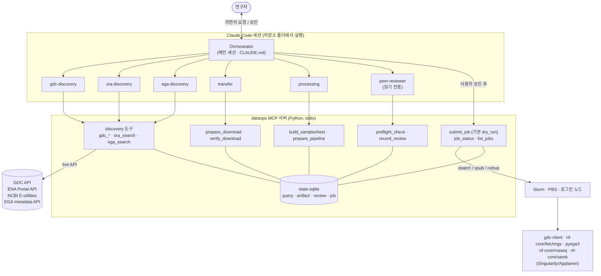

# genomics-dataops-team

연구자가 자연어로 요청하면 **GDC / SRA·ENA·GEO / EGA**에서 코호트를 찾고, 다운로드하고,
**nf-core 파이프라인**을 돌려주는 "DataOps 팀"을 **연구실 온프레미스 HPC**에서 Claude Code로 운영하기 위한 저장소입니다.

- 서버의 `claude` 세션 자체가 **Orchestrator**입니다 (규칙: [`CLAUDE.md`](CLAUDE.md)).
- 역할별 **subagent 6개**가 일을 나눠 맡습니다 ([`.claude/agents/`](.claude/agents)).
- **MCP 서버**(`dataops_mcp/`, Python)가 live API 조회와 job 스크립트 생성을 담당합니다.
- 실제 다운로드와 계산은 검증된 도구(gdc-client, nf-core/fetchngs, pyega3, nf-core 파이프라인)가 **스케줄러 job**으로 수행합니다.

AWS 기반 사례(VDOT)와 비교하면, 에이전트 런타임 자리를 Claude Code가, AWS Batch 자리를 Slurm/PBS가 맡는 구조입니다.
AWS 인프라 없이 `git clone` → `./install.sh` → `claude`로 바로 쓸 수 있습니다.

---

## 구조



### 설계 원칙과 실제 강제 방법

| 원칙 | 코드/설정에서 강제하는 방법 |
|---|---|
| **역할 분리** | subagent마다 frontmatter `tools`로 허용 MCP 도구를 제한. discovery 3종은 자기 저장소 도구만, transfer·processing은 제출 도구가 없음, peer-reviewer는 읽기 전용 + 검수 기록만 |
| **근거 기반** | 모든 discovery 결과에 `query_id`와 실제 호출한 `api_queries`(URL·filters)가 붙고 SQLite에 저장됨. 숫자는 도구 결과로만 보고(CLAUDE.md·각 agent 규칙) |
| **추론과 실행 분리** | LLM은 파라미터만 넘기고, 스크립트는 Jinja2 템플릿으로 생성. `.claude/settings.json`이 `sbatch`/`qsub`/`nextflow run`/`gdc-client`/`pyega3` 직접 실행을 deny |
| **안전장치** | `submit_job` 기본값 `dry_run=True`. 실제 제출은 ① `confirm=True` ② `dry_run=False` ③ 현재 스크립트 **묶음 해시**와 일치하는 peer-reviewer **PASS** 기록 ④ 동시 실행 한도 미만일 때만. 또 Claude Code가 `submit_job` 호출마다 사람에게 승인을 묻습니다(`ask` 규칙 + 도구 메타 `anthropic/requiresUserInteraction`) |

추가 안전장치:
- **묶음 해시**: 스크립트와 그 입력(manifest, samplesheet, params.yaml, nextflow config)의 sha256을 생성 시점에 기록합니다. 검수 뒤 한 글자라도 바뀌면 제출이 거부됩니다.
- **제출 범위 제한**: `state/scripts/` 아래에서 도구가 생성·등록한 스크립트만 제출할 수 있습니다.
- **자동 점검 우선**: peer-reviewer가 PASS를 줘도 자동 점검(`preflight_check`)에 FAIL이 있으면 FAIL로 기록됩니다.
- **크리덴셜**: 토큰·EGA 계정 파일은 경로로만 전달하고 내용은 읽지 않습니다. 권한이 600이 아니면 경고, 로그 출력은 토큰 형태 문자열을 가립니다. controlled 데이터 스크립트는 `umask 077`.
- `.claude/settings.json`의 Bash deny 규칙은 **보조 장치**입니다(Claude Code 문서상 명령 문자열 매칭이라 우회 가능). 실제 방어선은 MCP 서버 코드의 위 검사들입니다.

---

## 설치

요구사항: Linux HPC 로그인 노드, Python ≥ 3.10, [Claude Code](https://code.claude.com/docs), Java 17+ 및 Nextflow ≥ 25.10.4(파이프라인 실행 시), Singularity/Apptainer.

```bash
git clone https://github.com/Sejung98/Personal_dataops_agent.git genomics-dataops-team
cd genomics-dataops-team
./install.sh            # PYTHON=python3.11 ./install.sh 처럼 파이썬 지정 가능, --run-tests로 테스트까지
```

`install.sh`가 하는 일:
1. `.venv` 생성, 의존성 설치(`mcp`, `httpx`, `pyyaml`, `jinja2`, `pytest`, `respx`)
2. `config.yaml`이 없으면 `config.example.yaml`에서 복사(권한 600)
3. `.mcp.json`이 `.venv/bin/python -m dataops_mcp.server`를 가리키는지, 서버가 뜨는지 확인
4. `gdc-client`, `nextflow`, `java`, `pyega3`, `nf-core`, `sbatch`/`qsub`, `singularity`/`apptainer` 존재 여부 점검 → 없으면 **설치 방법만 안내**(자동 설치 안 함)
5. 토큰/크리덴셜 파일 권한 점검

그다음:

```bash
vi config.yaml          # 아래 '채워야 할 항목' 참고
claude                  # 반드시 저장소 폴더(루트)에서 실행
```

첫 실행 때 **폴더 신뢰(trust)** 와 **dataops MCP 서버 사용**을 허용하세요. 신뢰 전에는 `.claude/settings.json`의 allow 규칙이 적용되지 않아 도구마다 승인을 묻습니다(ask·deny 규칙은 바로 적용).
`claude`를 하위 폴더에서 실행하면 프로젝트 설정(`.claude/settings.json`)이 로드되지 않으니 루트에서 실행하세요.

### config.yaml에서 채워야 할 항목

| 항목 | 설명 |
|---|---|
| `scheduler` | `slurm` / `pbs` / `local` |
| `partition`, `account` | 기본 파티션(큐)과 과금 계정 |
| `transfer_node_mode` | 계산 노드 인터넷 여부: `compute`(가능) / `dtn`(전송 파티션) / `login`(로그인 노드에서 실행) |
| `transfer_partition` | `dtn` 모드일 때만 |
| `container` | `singularity` / `apptainer` / `docker` |
| `data_root`, `work_dir` | 다운로드·결과·Nextflow work 위치(대용량 스토리지) |
| `singularity_cache` | 컨테이너 이미지 캐시 |
| `gdc_token_path`, `ega_credentials_path` | controlled 데이터용 크리덴셜 **경로**(파일은 `chmod 600`) |
| `references` | 로컬 레퍼런스(fasta/gtf, assembly, species) — 오프라인 계산 노드면 필수 |
| `module_loads`, `tools` | 필요한 `module load` 줄, 실행 파일 경로 |

계산 노드 인터넷 확인: `srun --pty curl -sI https://api.gdc.cancer.gov/status` (PBS는 `qsub -I` 후 같은 명령).

---

## 사용 예시

### 1) "TCGA-BRCA의 WGS BAM 중 open access인 것 몇 개, 몇 TB인지 알려줘"

숫자만 확인하는 요청이므로 다운로드 단계로 가지 않습니다.

```
Orchestrator  계획: GDC / project=TCGA-BRCA, experimental_strategy=WGS, data_format=BAM, access=open
  └─ gdc-discovery
       ├─ gdc_get_field_values(field="experimental_strategy", filters={"project":"TCGA-BRCA"})  ← 값 철자 확인
       ├─ gdc_get_field_values(field="access", ...)
       └─ gdc_search_files(project="TCGA-BRCA", experimental_strategy="WGS", data_format="BAM", access="open")
            → query_id, n_files, n_cases, total_human, by_access, manifest 경로
            → api_queries: POST https://api.gdc.cancer.gov/files  filters={...}
Orchestrator  결과 요약 + 근거 쿼리 제시. 끝.
```

GDC에서 BAM·FASTQ 같은 원시 서열 데이터는 대부분 controlled access로 분류됩니다([GDC Controlled Access](https://docs.gdc.cancer.gov/Encyclopedia/pages/Controlled_Access/)). 그래서 `access=open` 결과가 0건이거나 매우 적을 수 있습니다. 이 경우 gdc-discovery가 access 조건을 빼고 다시 조회해 open/controlled 분포를 함께 보여주도록 되어 있습니다. 숫자는 항상 그 시점의 live API 결과입니다.

### 2) "PRJNA○○○○ RNA-seq 받아서 nf-core/rnaseq 돌려줘"

```
Orchestrator  계획 제시 → 승인
  └─ sra-discovery: sra_search(accession="PRJNA○○○○", library_strategy="RNA-Seq")
       → run/샘플 수, PAIRED/SINGLE 분포, 종(scientific_name), FASTQ 총 용량, 근거 쿼리
Orchestrator  요약 보여주고 확인 (종·layout·용량, 레퍼런스 선택)
  └─ transfer: prepare_download(query_id, nf_core_pipeline="rnaseq")
       → nf-core/fetchngs 1.13.0 스크립트 (transfer_node_mode에 따라 계산 노드/전송 파티션/로그인 노드)
  └─ peer-reviewer: preflight_check → 직접 검토 → record_review(PASS/FAIL)
Orchestrator  submit_job(script)  ← dry run으로 명령 확인
              사용자 "제출해" → submit_job(script, confirm=True, dry_run=False)  ← Claude Code 권한 확인 창
  … 다운로드 job 완료 …
  └─ transfer: verify_download(query_id)   (manifest 대비 파일·크기, fetchngs는 FTP 다운로드 시 md5 자체 검증)
  └─ processing: build_samplesheet(query_id, "rnaseq", strandedness="auto")
                 prepare_pipeline("rnaseq", samplesheet, params={"reference": "GRCh38_gencode_v44"})
       → nf-core/rnaseq 3.27.0 실행 스크립트 + params.yaml + 사이트 config (+ 오프라인이면 prefetch 명령)
  └─ peer-reviewer: 레퍼런스 종 일치, paired/single, 디스크, 버전 고정 점검 → record_review
Orchestrator  사용자 승인 → submit_job(..., confirm=True, dry_run=False) → job id·로그 경로 보고
```

- `strandedness="auto"`이면 nf-core/rnaseq가 FASTQ를 100만 read로 서브샘플링해 Salmon으로 strandedness를 추론합니다(파이프라인 문서). Salmon의 정량·편향 모델은 Patro 등(2017)에 기술되어 있습니다.
- nf-core/rnaseq 문서는 오래된 iGenomes 주석 대신 `--fasta`/`--gtf`를 직접 지정하라고 권장합니다. 그래서 `config.references`에 로컬 레퍼런스를 등록해 쓰는 방식을 기본으로 둡니다.

### 3) "어제 제출한 job 상태 알려줘"

subagent 없이 Orchestrator가 직접 처리합니다.

```
Orchestrator
  ├─ list_jobs(since_hours=48)          ← state DB + squeue/sacct(또는 qstat)로 상태 갱신
  └─ job_status(job_id) × N             ← 상태 + 로그 마지막 30줄(토큰 형태 문자열 가림)
→ RUNNING/COMPLETED/FAILED 요약, 실패 job은 로그 근거와 재실행(-resume) 방안 제시
   (재제출도 같은 검수·승인 절차)
```

---

## MCP 도구

| 그룹 | 도구 | 비고 |
|---|---|---|
| 환경 | `check_environment` | 설정 요약, CLI 존재, 크리덴셜 권한(내용은 읽지 않음) |
| GDC | `gdc_search_files`, `gdc_search_cases`, `gdc_get_field_values` | `/files`, `/cases`, facets, `_mapping`. manifest(`id filename md5 size state`) 생성 |
| SRA/ENA/GEO | `sra_search` | ENA Portal API `filereport`(result=read_run). GSE/GSM은 NCBI E-utilities로 SRA run 해석, ENA 미반영 run은 NCBI runinfo로 보조 |
| EGA | `ega_search` | `https://metadata.ega-archive.org` 공개 메타데이터 API (EGAS/EGAD/EGAF) |
| 기록 | `get_query`, `list_queries` | query_id로 근거·요약 재조회 |
| 전송 | `prepare_download`, `verify_download` | gdc-client / nf-core/fetchngs / pyega3 스크립트, manifest 대조·md5 |
| 처리 | `build_samplesheet`, `prepare_pipeline` | nf-core/rnaseq, nf-core/sarek. 버전은 X.Y.Z 고정 |
| 검수 | `preflight_check`, `record_review` | 레퍼런스·layout·디스크·controlled·버전·무결성 |
| 실행 | `submit_job`, `job_status`, `list_jobs` | 기본 dry run, 승인·검수·해시·동시성 확인 |

### peer-reviewer 자동 점검 항목

| 항목 | FAIL 예시 |
|---|---|
| 레퍼런스 일치 | 입력 종(ENA `scientific_name`)과 레퍼런스 종이 다름. 정렬된 BAM의 assembly와 레퍼런스 assembly가 다름 |
| paired/single | 메타데이터는 PAIRED인데 samplesheet에 mate 누락. sarek에 single-end FASTQ |
| 디스크 여유 | 다운로드 용량 × `disk_headroom`, work 예상 용량 > 가용 공간 |
| controlled-access | 사용자 확인 기록 없음, 저장 위치가 other 사용자에게 열림, `umask 077` 없음, 크리덴셜 파일 없음 |
| 버전 고정 | `-r X.Y.Z`가 아님 (dev/master/latest) |
| 기타 | 스크립트·입력 변경(해시 불일치), 스크립트에 토큰 값 직접 기재, 오프라인 계산 노드에서 iGenomes 사용, sarek `ascat`/`controlfreec`/`varlociraptor`인데 sex=NA |

**레퍼런스 일치 점검의 근거**: GDC는 모든 DNA-seq 정렬을 GRCh38.d1.vd1(GRCh38 + decoy + 바이러스 서열)로 수행하고 MarkDuplicates와 BQSR까지 적용합니다(Zhang 등 2021; [GDC DNA-Seq 파이프라인 문서](https://docs.gdc.cancer.gov/Data/Bioinformatics_Pipelines/DNA_Seq_Variant_Calling_Pipeline/)). 그래서 GDC BAM은 sarek에서 `step=variant_calling`으로 넣을 수 있습니다. 다만 sarek 기본 레퍼런스 `GATK.GRCh38`과는 contig 구성이 다릅니다. 같은 GRCh38.d1.vd1 fasta를 `config.references`에 `assembly: GRCh38.d1.vd1`로 등록해야 점검을 통과합니다. sarek의 구조와 입력 단계는 Garcia 등(2020)과 Hanssen 등(2024)에 기술되어 있습니다.

---

## 저장소 구조

```
.
├── CLAUDE.md                  # Orchestrator 규칙 (메인 세션이 읽음)
├── .mcp.json                  # MCP 서버 등록: ${CLAUDE_PROJECT_DIR}/.venv/bin/python -m dataops_mcp.server
├── .claude/
│   ├── settings.json          # 권한: discovery 등 allow, submit_job ask, 직접 실행 deny
│   └── agents/                # gdc-discovery, sra-discovery, ega-discovery, transfer, processing, peer-reviewer
├── dataops_mcp/
│   ├── server.py              # MCP 서버 (mcp 1.x FastMCP / 2.x MCPServer 모두 지원)
│   ├── gdc.py  sra.py  ega.py # discovery (live API, 근거 쿼리 기록)
│   ├── transfer.py            # prepare/verify download, submit_job, job_status, list_jobs
│   ├── processing.py          # samplesheet, nextflow 실행 스크립트
│   ├── review.py              # preflight_check, record_review
│   ├── scheduler.py           # slurm / pbs / local 추상화
│   ├── state.py               # SQLite: query·artifact·review·job·verification
│   ├── render.py              # Jinja2 렌더링 + 묶음 해시
│   ├── security.py  http.py  config.py  util.py
│   └── templates/             # base / gdc_download / ega_download / nextflow_run / nextflow_site.config / md5_verify
├── config.example.yaml
├── install.sh
├── pyproject.toml
└── tests/                     # respx 기반 단위 테스트 + @pytest.mark.live 스모크 테스트
```

생성물은 모두 `state/`(스크립트·manifest·samplesheet·로그·SQLite), `data/`, `work/` 아래에 쌓이며 git에서 제외됩니다.

## 테스트

```bash
.venv/bin/python -m pytest -q          # 단위 테스트 (HTTP는 respx로 mock)
.venv/bin/python -m pytest -m live -s  # 실제 GDC/ENA/NCBI/EGA API 스모크 테스트 (인터넷 필요)
```

단위 테스트는 discovery 응답 파싱, manifest/스크립트/samplesheet 생성, 검수 항목, 그리고 안전장치를 다룹니다. 안전장치 테스트 항목:
dry_run 기본값, confirm 없는 제출 거부, 검수 없는 제출 거부, 검수 후 스크립트·manifest 변경 시 거부, 등록되지 않은 스크립트 거부, 동시 실행 한도.

---

## 한계와 주의사항

- **controlled-access 데이터(GDC controlled, EGA 전체)는 DAC 승인과 기관 규정을 먼저 확인하세요.** 도구는 사용자 확인 플래그와 파일 권한만 점검할 수 있고, 승인 범위(연구 목적, 보관 기간, 공유 가능 여부)는 확인하지 못합니다. GDC controlled 데이터는 프로젝트별 dbGaP 승인이 필요합니다([GDC Controlled Access](https://docs.gdc.cancer.gov/Encyclopedia/pages/Controlled_Access/)). EGA는 데이터 제공자(DAC)가 접근을 승인하는 분산 모델입니다(Freeberg 등 2022).
- **EGA 메타데이터 API**: 개발 환경의 네트워크 제한으로 엔드포인트를 직접 호출해 검증하지 못했습니다. 공식 문서와 공개 클라이언트를 근거로 구현했고, 파일 객체 필드명은 여러 후보를 허용합니다. 처음 쓸 때 `pytest -m live -s`로 실제 응답을 확인하세요(`dataops_mcp/ega.py` 주석 참고). GDC와 ENA 쪽도 같은 이유로 공식 문서 원문, nf-core/fetchngs 소스, mock 테스트로만 검증했습니다.
- **GDC RNA-seq**는 정렬 BAM과 STAR counts로 제공되어 nf-core/rnaseq 입력(FASTQ)이 아닙니다. 발현량이 목적이면 GDC의 `Gene Expression Quantification`(STAR - Counts)을 바로 쓰는 편이 일반적입니다.
- **sarek FASTQ 입력은 paired-end만** 지원합니다(lane, fastq_2 필수). tumor/normal(`status`)과 sex는 메타데이터에서 확실하지 않으면 사용자에게 받습니다.
- **오프라인 계산 노드**: 파이프라인 코드·컨테이너·Nextflow 플러그인을 로그인 노드에서 미리 받아야 합니다(`prepare_pipeline` 결과의 `prefetch` 명령: `nextflow pull`, `nextflow plugin install`, `nf-core pipelines download`). iGenomes(S3) 레퍼런스는 쓸 수 없습니다.
- **로그인 노드 모드**(`transfer_node_mode: login`)는 대용량 전송을 로그인 노드에서 돌립니다. 기관 정책상 허용되는지 확인하고, 가능하면 `dtn` 모드를 쓰세요.
- **디스크 점검은 휴리스틱**입니다(`disk_headroom`, 파이프라인별 `work_expansion`). 쿼터(quota)는 `df` 여유 공간과 다를 수 있습니다.
- **SQLite** 상태 DB는 NFS/Lustre에서 잠금 문제가 생길 수 있습니다. `state_dir`은 홈이나 로컬 디스크에 두세요.
- PBS는 PBS Pro/OpenPBS 문법(`-l select=...`) 기준입니다. Torque는 지시문을 조정해야 합니다.
- 기본 파이프라인 버전(2026-10-30 기준 최신): nf-core/fetchngs 1.13.0, rnaseq 3.27.0, sarek 3.11.0. 업그레이드는 `config.yaml`의 `pipelines.*.version`을 바꾸고 해당 릴리스의 samplesheet 스키마를 확인한 뒤 하세요.

---

## 참고문헌

도구·데이터베이스 (PubMed 확인):

1. Ewels PA, et al. The nf-core framework for community-curated bioinformatics pipelines. *Nat Biotechnol.* 2020;38(3):276-278. [doi:10.1038/s41587-020-0439-x](https://doi.org/10.1038/s41587-020-0439-x)
2. Di Tommaso P, et al. Nextflow enables reproducible computational workflows. *Nat Biotechnol.* 2017;35(4):316-319. [doi:10.1038/nbt.3820](https://doi.org/10.1038/nbt.3820)
3. Garcia M, et al. Sarek: A portable workflow for whole-genome sequencing analysis of germline and somatic variants. *F1000Res.* 2020;9:63. [doi:10.12688/f1000research.16665.2](https://doi.org/10.12688/f1000research.16665.2)
4. Hanssen F, et al. Scalable and efficient DNA sequencing analysis on different compute infrastructures aiding variant discovery. *NAR Genom Bioinform.* 2024;6(2):lqae031. [doi:10.1093/nargab/lqae031](https://doi.org/10.1093/nargab/lqae031)
5. Patro R, et al. Salmon provides fast and bias-aware quantification of transcript expression. *Nat Methods.* 2017;14(4):417-419. [doi:10.1038/nmeth.4197](https://doi.org/10.1038/nmeth.4197)
6. Kurtzer GM, Sochat V, Bauer MW. Singularity: Scientific containers for mobility of compute. *PLoS One.* 2017;12(5):e0177459. [doi:10.1371/journal.pone.0177459](https://doi.org/10.1371/journal.pone.0177459)
7. Grossman RL, et al. Toward a Shared Vision for Cancer Genomic Data. *N Engl J Med.* 2016;375(12):1109-1112. [doi:10.1056/NEJMp1607591](https://doi.org/10.1056/NEJMp1607591)
8. Zhang Z, et al. Uniform genomic data analysis in the NCI Genomic Data Commons. *Nat Commun.* 2021;12(1):1226. [doi:10.1038/s41467-021-21254-9](https://doi.org/10.1038/s41467-021-21254-9)
9. Weinstein JN, et al. The Cancer Genome Atlas Pan-Cancer analysis project. *Nat Genet.* 2013;45(10):1113-1120. [doi:10.1038/ng.2764](https://doi.org/10.1038/ng.2764)
10. Katz K, et al. The Sequence Read Archive: a decade more of explosive growth. *Nucleic Acids Res.* 2022;50(D1):D387-D390. [doi:10.1093/nar/gkab1053](https://doi.org/10.1093/nar/gkab1053)
11. O'Cathail C, et al. The European Nucleotide Archive in 2024. *Nucleic Acids Res.* 2025;53(D1):D49-D55. [doi:10.1093/nar/gkae975](https://doi.org/10.1093/nar/gkae975)
12. Freeberg MA, et al. The European Genome-phenome Archive in 2021. *Nucleic Acids Res.* 2022;50(D1):D980-D987. [doi:10.1093/nar/gkab1059](https://doi.org/10.1093/nar/gkab1059)

API·도구 문서 (구현 근거, 2026-10-30 확인):
- GDC API Search & Retrieval / Downloading Files / Data Transfer Tool: <https://docs.gdc.cancer.gov/API/Users_Guide/Search_and_Retrieval/>, <https://docs.gdc.cancer.gov/API/Users_Guide/Downloading_Files/>, <https://docs.gdc.cancer.gov/Data_Transfer_Tool/Users_Guide/Data_Download_and_Upload/>
- ENA Portal API file reports: <https://ena-docs.readthedocs.io/en/latest/retrieval/programmatic-access/file-reports.html>
- NCBI E-utilities: <https://www.ncbi.nlm.nih.gov/books/NBK25499/>
- EGA Metadata Public API: <https://ega-archive.org/discovery/metadata/public-metadata-api/>
- pyEGA3: <https://github.com/EGA-archive/ega-download-client>
- nf-core/fetchngs 1.13.0, rnaseq 3.27.0, sarek 3.11.0의 `assets/schema_input.json`, `nextflow_schema.json`, `docs/usage.md`
